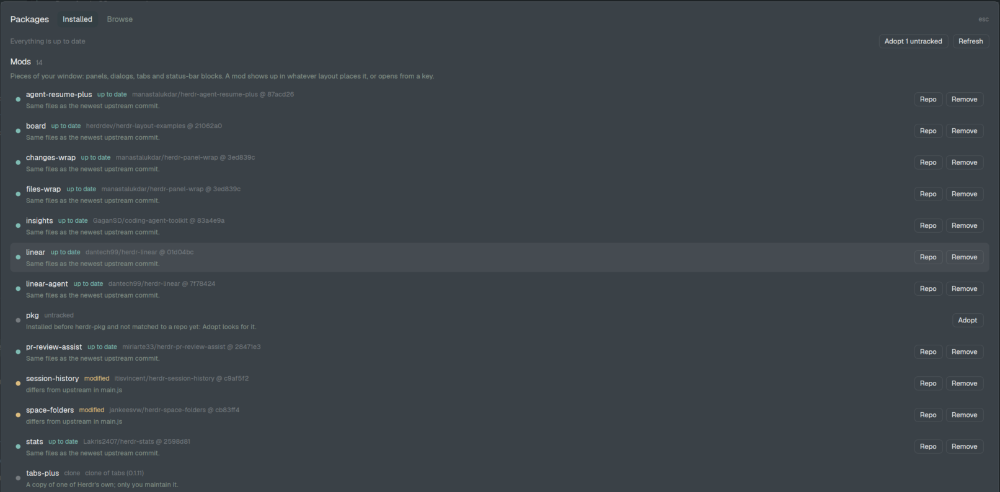

# herdr-pkg

**A package manager for [Herdr](https://herdr.dev) app mods and layouts: install, update and remove them, like `herdr plugin` does for the Herdr TUI. It also takes over the mods and layouts you installed before it.**



Herdr app updates itself and its own mods, but anything you add from [herdr.dev/mods](https://herdr.dev/mods) or [herdr.dev/layouts](https://herdr.dev/layouts) is copied into `~/.config/herdr-app` and never touched again. herdr-pkg records where each one came from and the commit you have, tells you when there's an update, and updates it while keeping your own edits.

## Mods and layouts

- **Mods** are pieces of your window: a panel, a dialog, a tab, a status-bar block. A mod shows up in whatever layout places it, or opens from a key.
- **Layouts** are whole-window arrangements of blocks. You use one at a time and switch with `ctrl-shift-l`.

A package on GitHub can hold either or both. herdr-pkg lists them in separate sections.

## Install

```sh
git clone https://github.com/manastalukdar/herdr-pkg
python3 herdr-pkg/scripts/install.py
```

It copies `mods/pkg` (after `herdr-app check`), binds **Alt+Shift+P** to the Packages dialog (unless that key is already yours), and runs `pkg.py adopt` once to match what you already have to its repos. `--no-adopt` skips that; `--uninstall` takes the mod and the key out again (what it tracks in `data/pkg/` stays). After that it updates itself: `pkg.py update pkg`.

Needs Python 3.8+ (standard library only) and `git`. With [`gh`](https://cli.github.com) logged in it uses your GitHub API quota (5,000 calls an hour); without it, the anonymous API (60 an hour; `GITHUB_TOKEN` raises that). Tested on Linux (Fedora 44, Herdr app 0.1.11); CI runs the tests on Linux, macOS and Windows, but the dialog itself is only tried on Linux. On Windows the dialog runs `py -3`, else `python`; use the same in place of `python3` below. A "tried it on my machine" report is welcome ([issues](../../issues)).

## Use it

**Alt+Shift+P** opens the Packages dialog:

- **Installed**: your mods and layouts, each with where it came from, the commit installed and a status: up to date, update (with the newest commit's message), modified (differs from upstream here), clone (a copy of one of Herdr's own, which only you maintain), personal, or untracked. Buttons per row: Update, Adopt, Repo, Remove (click twice). Update all and Adopt all at the top.
- **Browse**: every package herdr.dev lists (GitHub topics `herdr-mod` and `herdr-layout`), one row per package with its mods and layouts named, searchable. Review shows what a package adds, what its code does (runs programs, uses the network, reads or writes files), the keys it binds and any it can't because you use them; Install installs it. When its one mod has a name you already use, Review as `<name>-2` offers it under that name.

Everything the dialog does is also a command:

```sh
P=~/.config/herdr-app/mods/pkg/pkg.py
python3 $P list                                   # what's installed, mods and layouts apart
python3 $P outdated                               # which have updates (changes nothing)
python3 $P update [NAME...]                       # update; your local edits are merged in
python3 $P install OWNER/REPO[/FOLDER] [--ref REF] [--yes]  # review, then install with --yes
      ... [--as NAME]                             # its one mod under another name
python3 $P pin NAME [REF]                         # stay on REF (a tag or sha; default: the installed commit)
python3 $P unpin NAME                             # follow the default branch again
python3 $P remove NAME [--kind mod|layout]        # a copy goes to data/pkg/removed/
python3 $P adopt [NAME...] [--from OWNER/REPO]    # track things installed before herdr-pkg
python3 $P browse [QUERY]                         # herdr.dev's packages
```

Add `--json` for output a script (or the dialog) can read.

`install --ref BRANCH` (or `pin NAME BRANCH`) follows that branch instead of the default one. A tag or sha pins: `update` moves to it once and then leaves it alone, and `outdated` says **pinned**.

| `herdr plugin` (TUI) | herdr-pkg (app) |
|---|---|
| `install owner/repo[/subdir] [--ref]` | `install owner/repo[/folder] [--ref] [--yes]` |
| `update [plugin…]` | `update [name…]` |
| `list` | `list` |
| `uninstall` | `remove` |
| `link` / `unlink` | not yet ([issues](../../issues)) |
| `enable` / `disable` | none: a mod is on when a layout or key uses it |
| none | `adopt`, `outdated`, `browse` |

## How it works

- **Records.** `~/.config/herdr-app/data/pkg/packages.json` holds one record per mod or layout: the repo, the folder in it, the commit installed, the git blob hash of every file as installed, and the keys it bound. `log.jsonl` next to it lists every install, update, adopt and remove.
- **Adopting** (things installed before herdr-pkg). It hashes your files the way git does and compares them with the repos herdr.dev lists that have a package of that name (one tree per repo, fetched eight at a time and cached for a day), walking back through the commits that changed that folder until the files match. No match on every file means you changed it: it's recorded on the commit closest to your copy (most files equal, then most lines in common), marked modified, so updates merge into your changes rather than replace them. Copies of Herdr's own mods that nobody published are listed as clones and left alone. A repo herdr.dev doesn't list: `adopt NAME --from OWNER/REPO`.
- **Updating.** Each file is merged three ways with `git merge-file`: the installed commit's version, yours, and the new one. Files you didn't touch take upstream's; files only you changed stay yours; files both changed merge, and if that conflicts nothing is written: the merged files with conflict markers go to `data/pkg/conflicts/<name>/`. The row shows **conflict** until upstream moves on or a retry succeeds. A copy changed outside pkg (say, by a mod's own installer) that equals some upstream commit is re-based onto that commit first, so it doesn't conflict with itself. The new folder is staged next to the old one and swapped in; if `herdr-app check` then fails, the old one goes back. Files Herdr generates (`*.d.ts`, `jsconfig.json`) and an installer's `runtime.json` are left out of every comparison.
- **Installing** never overwrites: a mod or layout name you already have stops it. `--as NAME` installs a package's one mod under another name, renamed the way AGENTS.md says: its folder, its own `mods/<name>/` paths, the `"mod": "<name>"` in the package's layouts, and `mod.open:<name>` in its keys. The record keeps both names, and updates rewrite upstream's files the same way before comparing and merging, so a renamed mod updates like any other. It shows the scan first; the scan is a text match, so it can over-report, and it can't prove a package is safe.
- **No background work.** It checks for updates when you open the dialog (or run `outdated`); nothing runs otherwise.

## Development

```sh
python3 -m unittest discover -s tests     # against local git repos standing in for GitHub
herdr-app check mods/pkg
```

`pkg.py` is the whole package manager and its CLI; `main.js` is the dialog, which runs `pkg.py --json` and shows the result. The full spec is in [RECIPE.md](RECIPE.md).

## Credits

The risk scan and finding packages in a repo follow [herdr-app-mod-manager](https://github.com/jacksonpires/herdr-app-mod-manager) (speardragon, Jackson Pires; MIT). The command set follows the Herdr TUI's `herdr plugin`.

## License

MIT. See [LICENSE](LICENSE).
