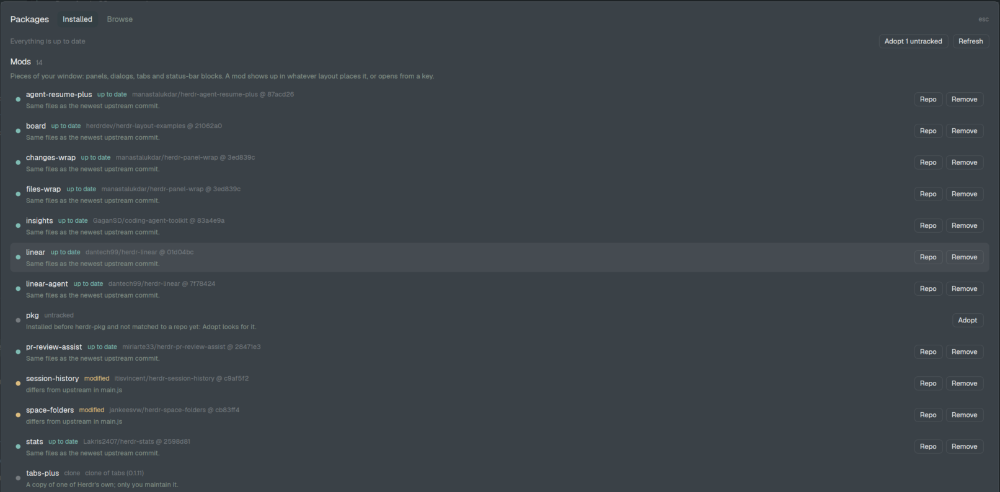

# Packages

A dialog for the mods and layouts you've added to Herdr app: where each came from, whether it has an update, and buttons to update, adopt, open the repo or remove it; a second tab lists herdr.dev's packages to review and install. Backed by a command-line package manager, `pkg.py`, that does the work.

## What you see

- **The dialog**: Herdr's `dialog` overlay, 80% of the window each way, `popover` background, 16px padding, 12px gaps.
- **Header**: "Packages" 15px semibold, then two tabs (28px, 7px corners; the current one on `selected`): **Installed** and **Browse**; `esc` in `dim` at the right.
- **Installed tab**:
  - a line: "Checking for updates…" in `working` while it checks, then "N updates available" or "Everything is up to date" in `dim`; at the right, buttons "Adopt N untracked" (when some are), "Update all (N)" (accent, when more than one) and "Refresh";
  - a scrolling list with two sections, **Mods** then **Layouts**: a 14px semibold title with its count in `dim`, one line in `muted` saying what that kind is (mods: pieces of your window that a layout places or a key opens; layouts: whole-window arrangements, one at a time, switched with ctrl-shift-l), then one row per item;
  - a row (6px vertical padding, 7px corners, `hover` background): an 8px dot in the status color; the name in `foreground` 13px, the status in its color 11px, and `source @ commit` in `dim`; below, in `muted` 11.5px, the newest commit (`→ abc1234 2026-11-01: subject`) for an update, the files that differ for a modified one, or what the status means; at the right its buttons (24px, 6px corners, `border`): **Update** (accent) when there's one, **Adopt** when untracked, **Repo** and **Remove** (reads "Remove?" after the first click) when tracked.
- **Statuses and colors**: up to date `done`; update `blocked`; modified `working`; clone, personal, untracked `dim`; missing `blocked`.
- **Browse tab**: a 32px search field (8px corners, `background`, `border`), a `dim` line "N of M packages from herdr.dev … Not reviewed by Herdr", then rows: `owner/repo / folder` and `★ N` (and "installed" in `done`), "Mods: … · Layouts: …" in `muted`, the repo description in `dim`; buttons **Review** (accent; "Details" when installed) and **Repo**. At most 150 rows show; the search narrows them.
- **Review**: a `dim` note that the scan can over-report and can't prove safety; sections "What it adds" (each mod with its file count and target folder, each layout), "What the code does" (one `blocked` line per mod and finding, or "No programs, network or file access found." in `done`), "Keys" (`+ key → action`, or `key stays X; it wanted Y` in `blocked`), and "Can't install" when a name is taken; buttons Repo, Back, and **Install** (accent) when it can.
- Below everything: what it's doing in `working`, or the last result in `foreground`, 12px.

## How it behaves

- Opening it lists what's installed at once (`pkg.py list`), then checks for updates (`pkg.py outdated`, network) and fills in the statuses.
- Update, Adopt, Remove, Install run the matching `pkg.py` command and refresh the list; an install or update posts a `success` notification.
- Browse loads herdr.dev's index the first time it's opened (cached a day); typing filters by repo, description, mod and layout names.
- `esc` goes back from Review to Browse, otherwise closes the dialog.
- No agent statuses: it doesn't show agents.

## Built from

- **Mod** `mods/pkg/`, `place: "none"`, `overlay: {kind: "dialog", width: 0.8, height: 0.8}`:
  - `main.js`: the view. Every action is `exec("python3", [appHome()/mods/pkg/pkg.py, "--json", …])`; `InputState`/`Input` for the search; `overflow_y_scrollbar` lists; `notify`, `closeOverlay`, `theme`, `window().platform` (to pick `xdg-open`, `open` or `explorer` for Repo).
  - `pkg.py`: the package manager (commands `list`, `adopt`, `outdated`, `update`, `install`, `remove`, `browse`; `--json`). Standard library, `git merge-file`, and GitHub through `gh api` or `urllib`. State in `data/pkg/` (`packages.json`, `log.jsonl`, `cache/`, `backup/`, `removed/`, `conflicts/`).
- **Keys**: `keys.json`, `"global": {"alt-shift-p": "mod.open:pkg"}`.
- **Layout**: none. It's opened by its key or `herdr-app do mod.open '{"name":"pkg"}'`.

## Watch out

- Mods can't run Python themselves: everything goes through `exec`, so the dialog stays responsive by doing the network work after the list shows.
- An update compares files, not commits: a newer repo commit that didn't change the package isn't an update.
- Adopting a patched copy: when no upstream commit matches every file, the base is the commit with the most files equal and then the most lines in common, so a three-way merge later keeps the patch. Picking the newest commit instead loses it.
- `herdr-app check` after writing; on failure the previous folder goes back.
- Generated files (`*.d.ts`, `jsconfig.json`, an installer's `runtime.json`) are never compared or copied.
- Anonymous GitHub API: 60 calls an hour, and building the index takes one per listed repo (about 220 today). Use `gh` or `GITHUB_TOKEN`.

## Done when

- `python3 -m unittest discover -s tests` and `herdr-app check mods/pkg` pass.
- `pkg.py adopt` on a home with mods installed by hand records each one's repo and the commit it matches; a patched one is marked modified.
- `pkg.py update` on a modified mod with an upstream change merges both; a conflicting one writes nothing and leaves the merged file in `data/pkg/conflicts/`.
- Alt+Shift+P shows Mods and Layouts in their own sections with their statuses; Browse lists herdr.dev's packages; Review then Install adds one.
